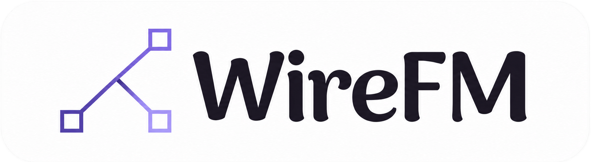

<p align="center">
  
</p>

<p align="center">
  <a href="https://github.com/jasmin1727/WireFM/releases/latest/download/WireFM.apk">
    
  </a>
  <a href="https://github.com/jasmin1727/WireFM/releases/latest/download/wirefm-desktop-linux-amd64">
    
  </a>
  <a href="#-quick-start-pc">
    
  </a>
</p>

<p align="center">
  
  
  
  
</p>

---

## 📥 Direct Downloads

> ### 📱 **[👉 Download Android APK (WireFM.apk)](https://github.com/jasmin1727/WireFM/releases/latest/download/WireFM.apk)**
> *Install directly on your phone with full Jetpack Compose M3 UI.*
>
> ### 🖥️ **[👉 Download Standalone Desktop GUI (wirefm-desktop-linux-amd64)](https://github.com/jasmin1727/WireFM/releases/latest/download/wirefm-desktop-linux-amd64)**
> *Standalone iOS-style file manager (< 20 MB size, < 40 MB RAM, No Electron).*

---

## ⚡ WireFM 2.0 Highlights

- 🖥️ **Standalone Desktop GUI File Manager**:
  - Ultra-lightweight native Wails desktop application (< 40 MB idle RAM).
  - Authentic iOS/macOS component aesthetic (`#0D0D11`, glassmorphism, pill badges).
  - Instant pairing QR Scanner card on launch.
  - Places & Devices sidebar (`Home`, `Desktop`, `Documents`, `Downloads`, `Vivo y36`).
  - 3-column `#CCD8DA` folder grid with breadcrumbs (`root > home > jasmin`).
  - Full OS drag-and-drop file transfer overlay.
- 🎨 **100% Jetpack Compose & Material 3 UI**:
  - Rebuilt ground-up in Kotlin & Jetpack Compose.
  - Deep AMOLED pitch black theme (`#000000`) with smooth spring animations.
  - Expressive pill tabs, segmented controls, and animated bottom sheets.
- 🎯 **Zero Setup**: 1 command to run on PC, 1 tap to scan on Android.
- 📷 **Ultra-Fast CameraX QR Pairing**:
  - Modern CameraX 60fps scanner with custom animated viewfinder laser sweep.
  - Auto-detection with instant haptic feedback on scan.
- 📂 **Bidirectional Dual Storage File Explorer**:
  - Seamless toggle between **PC Storage** and phone's **Internal Storage**.
  - Interactive breadcrumb navigation chips for instant parent directory jumping.
  - Grid & List view modes with rich color-coded file icons.
  - Smart copy, cut, paste, rename, delete (Recycle Bin), and multi-file upload.
- 🐧 **Native Linux Desktop Integration**:
  - Auto-mount phone directly into **Dolphin**, **Thunar**, or **Nautilus** via WebDAV.
- 🪶 **Ultra Lightweight Server**:
  - Single standalone binary with zero external dependencies.

---

## 💻 OS Availability & Support

| Operating System | Status | Details |
| :--- | :---: | :--- |
| 🐧 **Linux** | ✅ **Supported** | Full integration: Dolphin, Thunar, Nautilus, CLI & WebDAV mount (`mount_phone.sh`). |
| 📱 **Android** | ✅ **Supported** | 100% Jetpack Compose app with CameraX QR pairing, dual storage browsing, and background sync. |
| 🍎 **macOS** | 🧪 *Experimental* | Finder WebDAV script (`mount_mac.sh`) created. |
| 🪟 **Windows** | 🧪 *Experimental* | Network Drive scripts (`mount_windows.bat` / `.ps1`) created. |

---

## 🚀 Quick Start (PC)

### 1-Line Install (Arch / Ubuntu / Debian / Fedora):
```bash
curl -sSL https://raw.githubusercontent.com/jasmin1727/WireFM/main/install.sh | bash
```

### Run WireFM:
```bash
wirefm
```
*(Or specify a custom directory to share: `wirefm /path/to/folder`)*

Terminal will show:
1. Local IP & WebDAV endpoints.
2. An ASCII QR Code.
3. Scan with the **WireFM Android App**.
 
---

## 📱 WireFM Mobile App (Android)

1. Download [`WireFM.apk`](https://github.com/jasmin1727/WireFM/releases/latest/download/WireFM.apk) onto your phone and install.
2. Open the app and tap **"Scan"**.
3. Point your camera at the PC terminal's QR code.
4. 🎉 **Done!** You now have complete access to manage all files and folders.

---

## 🐧 Native Dolphin / Thunar Auto-Mount

Want to open your phone inside your favorite Linux File Manager?
```bash
./mount_phone.sh <PHONE_IP>
```
This mounts via `gio` / `kio-fuse` directly into Dolphin or Thunar sidebar!

---

## 🛠️ Architecture & Tech Stack

```
           ┌──────────────────────┐
           │     WireFM Core      │
           │  • Port 8080 (REST)  │
           │  • Port 8081 (WebDAV)│
           │  • Terminal QR Code  │
           └──────────┬───────────┘
                      │ Local Wi-Fi (HTTP / WebDAV)
                      ▼
           ┌──────────────────────┐
           │   WireFM (Compose)   │
           │  • 100% Jetpack Comp │
           │  • CameraX Analyzer  │
           │  • Dual-Storage FM   │
           │  • Material 3 AMOLED │
           └──────────────────────┘
```

---

## 📄 License

Distributed under the **MIT License**. See [`LICENSE`](LICENSE) for more information.

Copyright © 2026 **[Jasmin Thakor](https://github.com/jasmin1727)**
